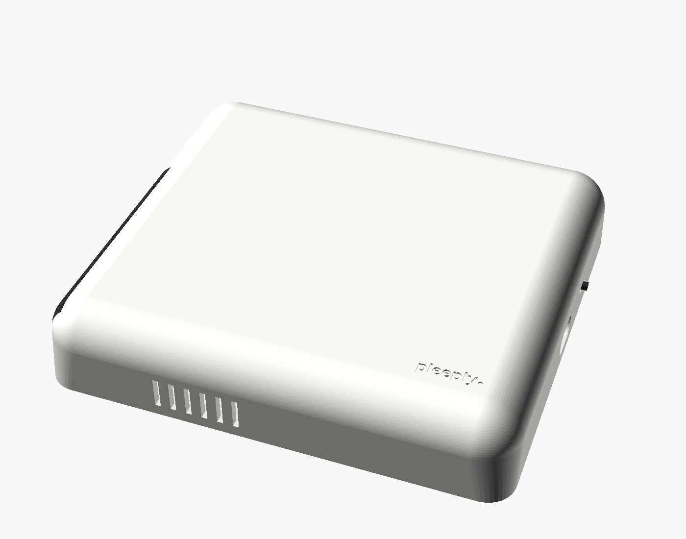
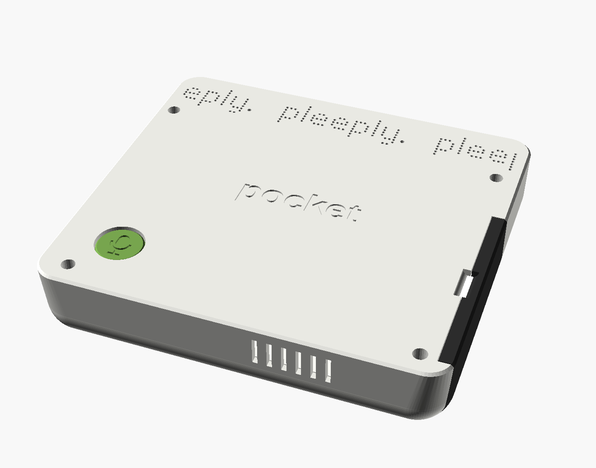
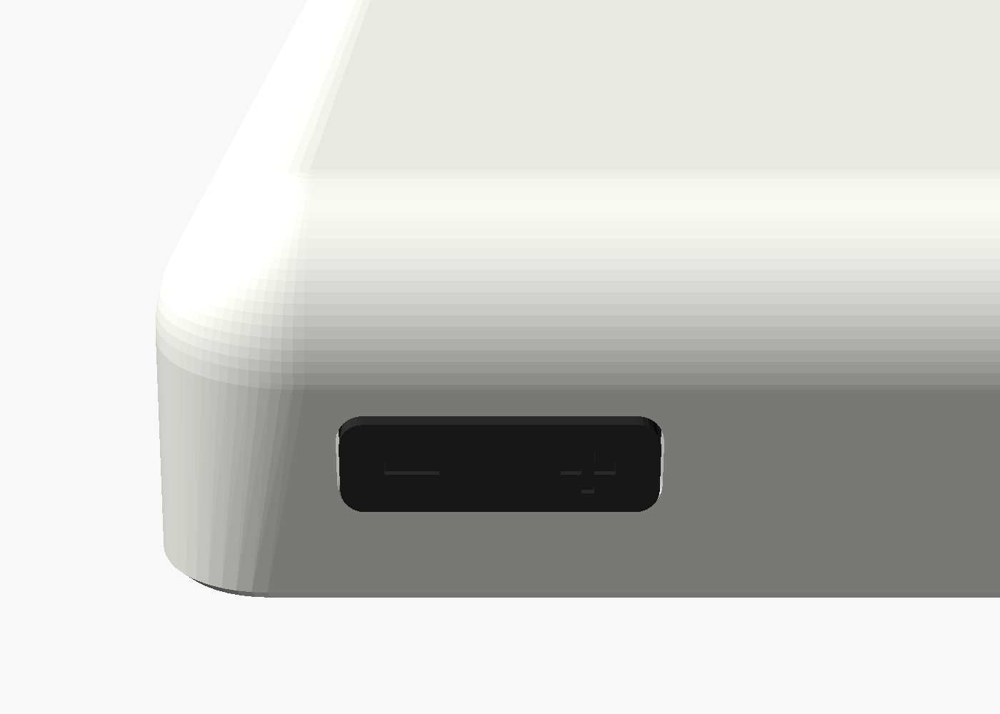
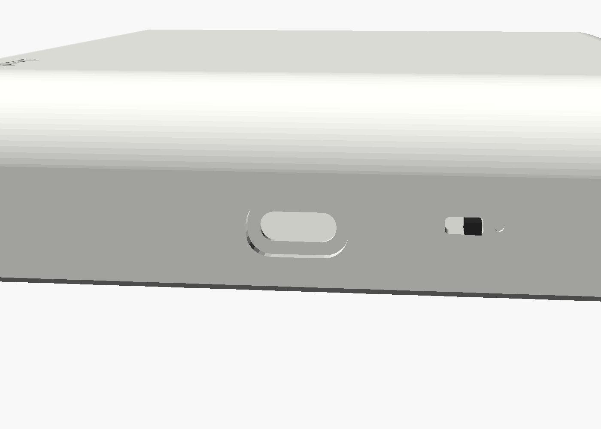
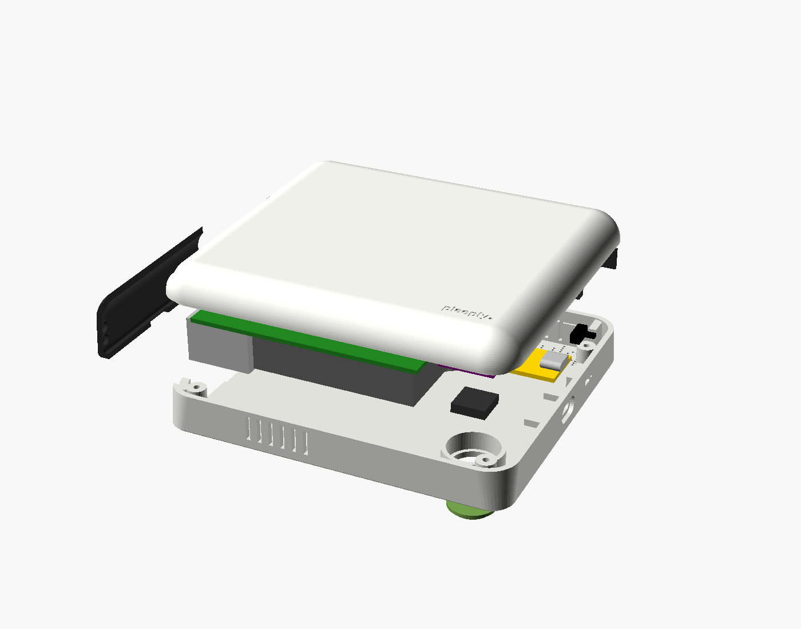
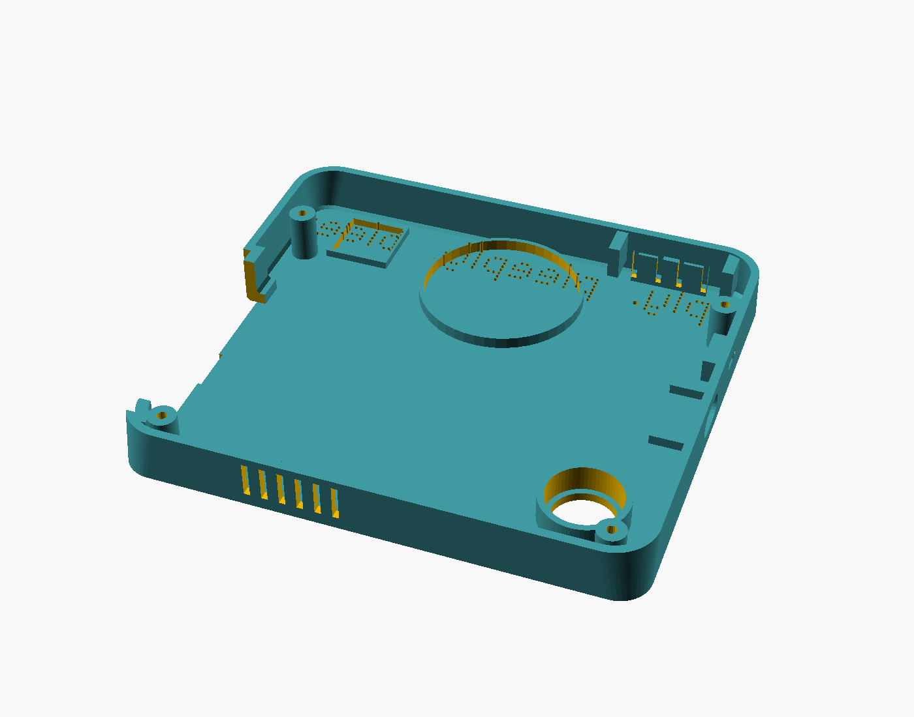
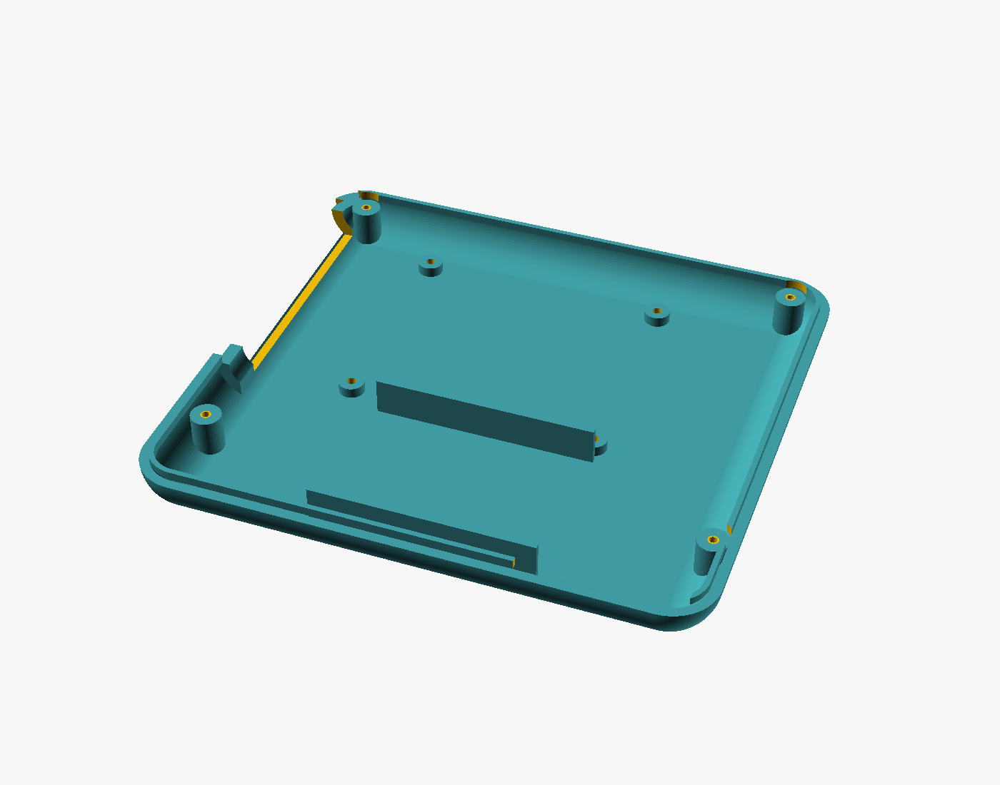
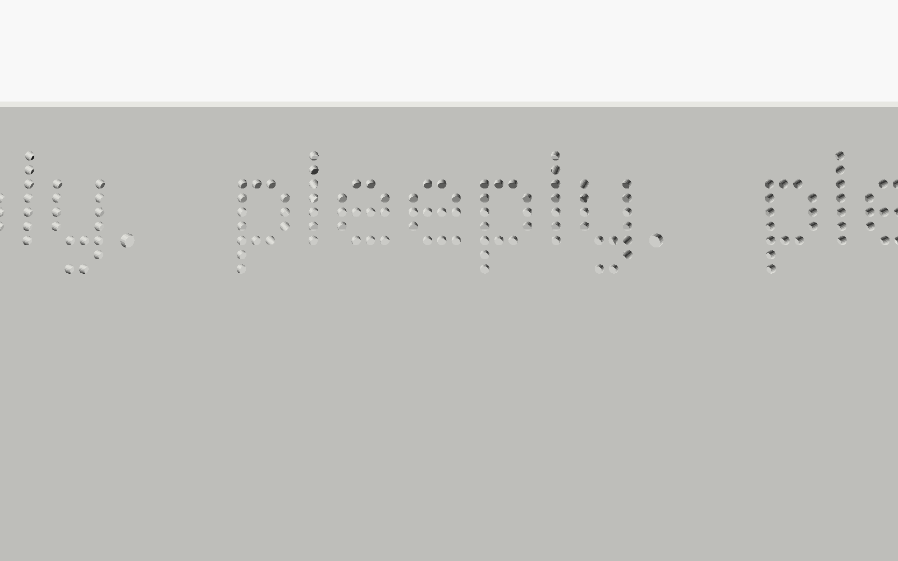

# pleeply Pocket — корпус прототипа

Карманный прототип pleeply на Raspberry Pi 5: кнопка push-to-talk, свой динамик и микрофон, батарея внутри.
Модель параметрическая: [`pleeply_pocket.scad`](pleeply_pocket.scad) (OpenSCAD 2025+, все размеры в начале файла).

| Верх | Плоское дно |
|---|---|
|  |  |
|  |  |
|  |  |
|  |  |

**Габарит:** 128 × 116 × 26 мм — как кусок мыла: дно полностью плоское, верх со скруглёнными рёбрами (R11), корпус лежит на дне.

**Почему 26 мм.** Это минимум для Pi 5: по официальному чертежу (лист 1:1) блок USB/Ethernet поднимается на 16,5 мм над платой, плюс плата 1,6 мм, стойки 2,5 мм (снизу у платы выступает до 1,9 мм) и две стенки по 2,2 мм. Поэтому над Pi ничего не лежит: Pi стоит в нижней половине, аккумулятор и динамик — над ней у верхнего края, а зарядка, выключатель, Pololu и усилитель — справа от Pi. Тоньше можно только на Compute Module 5 со своей платой-носителем.

## Что где

- **Верх:** гладкий, только мини-гравировка «pleeply.» в правом нижнем углу (буквы 3,2 мм, глубина 0,5 мм).
- **Плоское дно:** ровно по центру гравировка «pocket» (буквы 9 мм, глубина 0,6 мм). У верхнего края — бегущая строка «pleeply.» точечным шрифтом от края до края: повторы обрезаны по краю дна, отверстия Ø1,0 мм с шагом 1,5 мм, строка 120 × 13 мм и обходит стойки под винты. За серединой строки стоит динамик и звучит через буквы, микрофон — за отверстием справа (если смотреть на дно). Слева внизу круглая кнопка PTT Ø15 с гравировкой микрофона, утоплена на 0,6 мм, чтобы стол её не нажимал. Четыре винта M2.
- **Левый бок:** отсек разъёмов Pi (USB, Ethernet) под крышкой на 4 магнитах. Крышка снимается за выемку на шве со стороны дна.
- **Правый бок:** гнездо зарядки USB-C (это гнездо самой платы TP4056) с выемкой под корпус штекера; над ним ползунковый выключатель: вверх — включено, рядом точка-метка. Заряжать можно, не снимая крышку.
- **Верхний бок:** качелька громкости («+» справа, если смотреть на дно).
- **Нижний бок:** шесть вентиляционных прорезей у кулера Pi.

## Детали — что именно покупать

Смета с ценами в тенге и ссылками, где купить: [BOM.md](BOM.md). Итог около 209–226 тыс. ₸ на один прототип.

Модель построена под эти детали. Размеры Pi 5 сверены с официальным чертежом, кулера — с документом Raspberry Pi, Pololu — со страницей производителя. Размеры модулей с AliExpress у продавцов отличаются: перед печатью сверь свои детали с колонкой «Проверить» и при расхождении поправь параметр в начале `.scad`.

| Деталь | Что искать | Где | Проверить |
|---|---|---|---|
| Raspberry Pi 5, 4 или 8 ГБ | «Raspberry Pi 5 8GB» | Satu.kz, Kaspi.kz, AliExpress | — |
| Официальный кулер | «Raspberry Pi Active Cooler» (официальный, 63,5 × 42,5 × 13,7 мм) | там же, где Pi | высота ≤ 15 мм над платой |
| Карта microSD | microSD A2, 64 ГБ | Kaspi.kz, любой магазин | — |
| Аккумулятор | «103565 3000mAh 3.7V LiPo PCM JST PH2.0» — с платой защиты | AliExpress, Kaspi.kz | с платой защиты ≤ 67 × 36 × 10,5 мм (`bat`) |
| Зарядка | «TP4056 Type-C 1A charger module with protection» (DW01A + 8205A, выводы IN, B+/B−, OUT+/OUT−) | AliExpress, Kaspi.kz | плата ≈ 26 × 17,5 мм, гнездо на коротком торце (`usbc_pcb`) |
| Повышение до 5 В | **Pololu U3V40F5** (№ 4012), вывод EN, 15,2 × 15,2 × 5,6 мм | pololu.com (доставка в КЗ), RobotShop | — |
| Микрофон | «INMP441 I2S microphone module» | AliExpress, Kaspi.kz | плата 14 × 14 мм, толщина ≤ 3 мм |
| Усилитель | «MAX98357A I2S 3W amplifier module» | AliExpress, Kaspi.kz | ≤ 20 × 18 мм |
| Динамик | «40mm 4ohm 3W ultra thin speaker» | AliExpress | **толщина ≤ 10 мм** (бывают ~5 мм); обычные 40-мм глубиной 20 мм не влезут |
| Кнопка PTT | «12x12x4.3 tactile switch» (низкая, плоский толкатель, выводная) | AliExpress, Kaspi.kz | высота 4,3 мм |
| Кнопки громкости | «6x6x4.3 tactile switch DIP», 2 шт | AliExpress, Kaspi.kz | — |
| Выключатель | «SS12D00G4» или «SS12D01G4» (SPDT, 3 ножки, рычажок 4 мм) | AliExpress | корпус ≈ 8,6 × 3,6 × 3,5 мм (`pwr_body`) |
| Магниты | «неодимовый магнит 4×1,5 мм», 8 шт | AliExpress, Kaspi.kz | — |
| Винты | саморезы M2 × 12 (4 шт) и M2,5 × 4 (4 шт) | AliExpress, крепёжный магазин | — |
| Мелочи | силиконовый провод 28 AWG, термоусадка, двусторонний и вспененный скотч | любой | — |

На Satu.kz на момент проверки (23.10.2026) были объявления Raspberry Pi 5 8 ГБ за 172 000 ₸ и 4 ГБ за 112 000 ₸; цены и наличие у продавцов меняются.

## Детали для печати — `stl/`

| Файл | Как класть | Поддержки | ~PETG |
|---|---|---|---|
| `pleeply-pocket-front.stl` — верх | верхом на стол (уже повёрнут) | только от стола, если принтер плохо держит первые мм скругления | 50 г |
| `pleeply-pocket-back.stl` — поддон с плоским дном | дном на стол | не нужны | 58 г |
| `pleeply-pocket-door.stl` | наружной стенкой на стол | не нужны | 5 г |
| `pleeply-pocket-ptt.stl` — колпачок PTT | верхом на стол | не нужны | 1 г |
| `pleeply-pocket-ptt_plate.stl` — площадка PTT | диском на стол | не нужны | 1 г |
| `pleeply-pocket-rocker.stl` | клавишей на стол | не нужны | 1 г |

PETG или PLA, слой 0,2 мм, 4 периметра (стенка 2,2 мм), заполнение 20 %. Всего около 114 г пластика.

Пересобрать STL после правки параметров:

```bash
for p in front back door ptt ptt_plate rocker; do openscad --backend=Manifold --export-format=binstl -D "part=\"$p\"" -o stl/pleeply-pocket-$p.stl pleeply_pocket.scad; done
```

Вид сборки: `-D 'part="assembly"'`, плоское дно: `"bottom_view"`, разнесённый: `"exploded"`, разрез: `"section"`.
Шаги инструкции: `-D 'part="step"' -D 'step=1'` … `12`; карты всех деталей: `"tray_map"` (поддон) и `"top_map"` (верх).
Проверка столкновений: `-D 'part="clash"' -D 'check="components"'` (ещё `ptt`, `ptt_plate`, `rocker`, `door`). Результат должен быть пустым или нулевой толщины: это касания.

## Сборка — 12 шагов

Та же инструкция страницей для телефона (карта деталей с номерами, отметки «Сделано»): https://claude.ai/artifact/K45ystTPgHEo7Y2aMr3Mwx — приватная, открывается только из твоего аккаунта.

Картинки к каждому шагу — в [`renders/steps/`](renders/steps/): зелёным — что ставим сейчас, серым — что уже стоит. Где что лежит целиком: [поддон](renders/steps/map-tray.png) и [верх](renders/steps/map-top.png).

**Поддон** — положи плоским дном на стол и смотри внутрь: проём отсека слева, USB-C справа, качелька на дальней стенке.

1. **Магниты.** По два магнита Ø4 × 1,5 — в обе полки у проёма отсека слева, на суперклей, одним полюсом наружу. Ещё 4 — в крышку отсека так, чтобы притягивались к первым.
2. **Кнопка PTT** — ближний правый угол. Колпачок с микрофоном вставь изнутри в круглое отверстие, фланцем к стенке. На него положи кнопку 12×12×4,3 толкателем к колпачку. Надень площадку юбкой на люльку, ножки — в прорези, приклей по юбке. Провода припаяй к ножкам снаружи площадки, на диагональные ножки: это всегда разные контакты.
3. **Качелька** — дальняя стенка справа. Клавишу вставь изнутри в прорезь, фланцем к стенке. Две кнопки 6×6 опусти сверху в гнёзда кронштейна, ножками в прорези, толкателями к штырькам клавиши; приклей.
4. **Зарядка TP4056** — правая стенка. Задвинь плату между направляющими, чтобы USB-C вошёл в вырез; приклей.
5. **Выключатель** — правая стенка, дальше гнезда. Вставь изнутри в рамку, рычажком в прорезь; приклей.
6. **Динамик** — у дальней стенки посередине, за строкой «pleeply.». Посади диффузором к дну в кольцо, по краю — клей.
7. **Микрофон INMP441** — дальний левый угол. Вложи в рамку портом к дну; вокруг порта — кольцо из вспененного скотча.

**Верх** — переверни внутренней стороной вверх: проём отсека остаётся слева.

8. **Аккумулятор** — между двумя длинными направляющими у ближнего края, на двусторонний скотч.
9. **Pololu и усилитель MAX98357A** — справа от места под Pi, на двусторонний скотч к внутренней стороне верха: усилитель дальше от тебя, Pololu ближе, к аккумулятору.
10. **Raspberry Pi 5** с кулером — сначала вставь microSD (потом слот окажется внутри корпуса), затем на 4 стойки компонентами вверх, USB и Ethernet к проёму отсека; 4 самореза M2,5 × 4.
11. **Провода и сведение.** Соедини всё по таблице ниже (на гребёнку GPIO паяй напрямую). Положи верх на поддон: бортик верха заходит внутрь. 4 самореза M2 × 12 со стороны дна.
12. **Крышка отсека** — на магниты. Готово.

### Распиновка (номера контактов гребёнки Pi)

| Откуда | Куда |
|---|---|
| TP4056 B+ / B− | аккумулятор + / − |
| TP4056 OUT+ / OUT− | Pololu VIN / GND |
| Pololu VOUT / GND | 5V (2) / GND (6) |
| Выключатель: средний / верхний («вкл») / нижний («выкл») | Pololu EN / TP4056 OUT+ / GND |
| INMP441 VDD / GND / L/R | 3V3 (1) / GND (9) / GND |
| INMP441 SCK / WS / SD | GPIO18 (12) / GPIO19 (35) / GPIO20 (38) |
| MAX98357A Vin / GND | 5V (4) / GND (14) |
| MAX98357A BCLK / LRC / DIN | GPIO18 (12) / GPIO19 (35) / GPIO21 (40) |
| Динамик | выход MAX98357A + / − |
| PTT | GPIO17 (11) и GND (20) |
| Громкость + / − | GPIO22 (15) / GPIO23 (16), общий GND (25) |

`/boot/firmware/config.txt`, отправная точка (проверить на железе):

```
dtparam=i2s=on
dtoverlay=googlevoicehat-soundcard   # INMP441 + MAX98357A на одной шине I2S
usb_max_current_enable=1             # питание через GPIO: иначе USB ограничены 600 мА
```

Кнопкам включить внутреннюю подтяжку к 3V3 и читать нажатие как 0. В EEPROM Pi задай `PSU_MAX_CURRENT=5000` (`sudo rpi-eeprom-config -e`), иначе Pi предупреждает о слабом питании.

## Честно о прототипе

- **Питание:** Pololu U3V40F5 от аккумулятора даёт около 3 А на 5 В (оценка по формуле производителя, реальный предел зависит от нагрева). Pi 5 под нагрузкой локальной модели берёт примерно 1,5–2 А — хватает, но USB-устройства с большим током подключать не стоит.
- **Выключатель:** ползунок слаботочный (около 0,3 А), поэтому он переключает только вход EN платы Pololu, а не 5 В.
- **Зарядка:** TP4056 заряжает током 1 А, полный заряд 3000 мА·ч — около 3,5 часа. Заряжать лучше выключенным: под нагрузкой TP4056 может не закончить заряд правильно.
- **Звук:** динамик звучит через буквы: над ним 51 отверстие Ø1,0 мм, это около 3,5 % площади диффузора. Звук будет заметно тише и глуше, чем через открытую решётку. Если мало: подними `mic_hole` до 1,2 мм.
- **Время работы:** аккумулятор 11 Вт·ч — примерно **1 час под нагрузкой локальной модели** и около 2 часов в простое.
- **Нагрев:** кулер обязателен. Воздух выходит через прорези на нижнем боку.
- **Корпус лежит на дне, а динамик и микрофон смотрят в дно.** На столе звук приглушается: говорить и слушать удобнее, держа его в руке.
- **Что проверить после первой печати:** все ли отверстия надписи открылись (заплывшие прочисти сверлом 1,0 мм), люфт колпачка PTT (`fit`), посадку площадки PTT на люльку, зазор штока до кнопки (`sw12_top`, сейчас 0,4 мм), ход качельки и рычажка выключателя (`pwr_travel`), посадку TP4056 и штекера USB-C, усилие магнитов крышки, совпадение стоек с отверстиями Pi.
